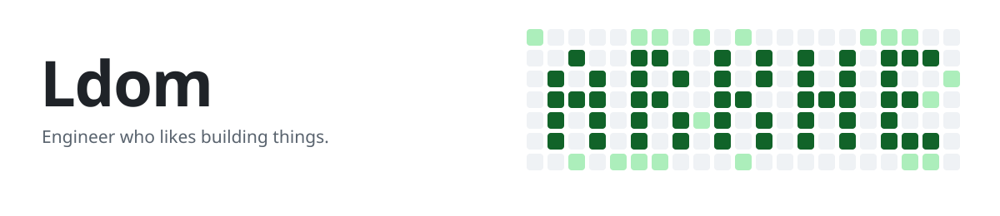

<picture>
  <source media="(prefers-color-scheme: dark)" srcset="assets/banner-dark.svg">
  
</picture>

### Data / DevOps / HPC / AI Agents

Data and HPC orchestration for energy and industrial systems, on sovereign infrastructure. Open-source tooling for AI agents.

[Articles on Medium](https://medium.com/@louis_10840) &nbsp;&nbsp; [Dom Universe](https://dombot.tech)

## AI agents

Open-source tools. Writes are previewed; memory stays in Notion, Obsidian or on your own server.

<table>
  <tr>
    <td width="33%" valign="top">
      <h3><a href="https://github.com/ldom1/notion-pilot-powers">notion-pilot-powers</a></h3>
      
Claude skills and a local MCP server for a Notion CRM: leads, contacts, French company data (SIREN, sector, size).

      
<a href="https://notion-pilot.com/?utm_source=github&utm_medium=profile&utm_content=notion-pilot-powers">notion-pilot.com</a>

      
<code>Python</code> <code>MCP</code> <code>Notion API</code>

      
      
    </td>
    <td width="33%" valign="top">
      <h3><a href="https://github.com/ldom1/ai-dotfiles">ai-dotfiles</a></h3>
      
One config and one shared memory for Claude Code, Cursor and Mistral Vibe, backed by an Obsidian vault.

      
<a href="https://github.com/ldom1/ai-dotfiles/blob/main/docs/skills.md#install-a-skill">Skills</a>

      
<code>Python</code> <code>Shell</code> <code>MCP</code>

      
      
    </td>
    <td width="33%" valign="top">
      <h3><a href="https://github.com/ldom1/clawvis">Clawvis</a></h3>
      
Self-hosted hub for agents: Kanban, memory, skills.

      
<a href="https://github.com/ldom1/clawvis#install">Install</a>

      
<code>Python</code> <code>Docker</code> <code>Self-hosted</code>

      
      
    </td>
  </tr>
</table>

## Stack

**AI** &nbsp;

**Data** &nbsp;

**Orchestrate** &nbsp;

**Run** &nbsp;

**Build** &nbsp;

**Cloud** &nbsp;

## Writing

<!-- BLOG-POST-LIST:START -->
- [From a company name to a precise email, tailored to your prospect with Claude and Outlook…](https://medium.com/@louis_10840/from-a-company-name-to-a-precise-email-tailored-to-your-prospect-with-claude-and-outlook-174328406d34?source=rss-525216d415bf------2)
- [WSL won’t start? Rescue your distro without losing your ext4.vhdx](https://medium.com/@louis_10840/wsl-wont-start-rescue-your-distro-without-losing-your-ext4-vhdx-5bf60bea1b3a?source=rss-525216d415bf------2)
- [I stopped using OpenClaw. Now I rent the loop and own the memory.](https://medium.com/@louis_10840/i-stopped-using-openclaw-now-i-rent-the-loop-and-own-the-memory-529054d042cb?source=rss-525216d415bf------2)
- [Orchestrate Workflows with Airflow: Complete Implementation](https://medium.com/@louis_10840/orchestrate-workflows-with-airflow-complete-implementation-49c6f2638efd?source=rss-525216d415bf------2)
- [Orchestrate Workflows with Airflow: Overview](https://medium.com/@louis_10840/orchestrate-workflows-with-airflow-overview-310117f51ff0?source=rss-525216d415bf------2)
<!-- BLOG-POST-LIST:END -->

[All articles on Medium](https://medium.com/@louis_10840)
